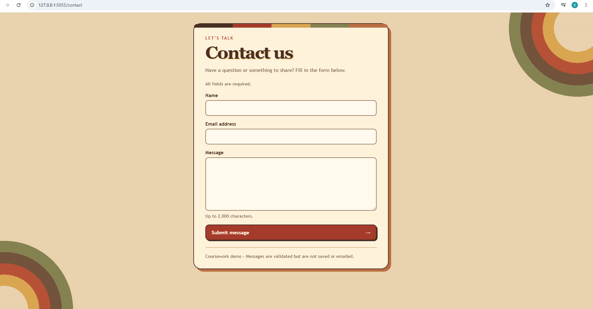
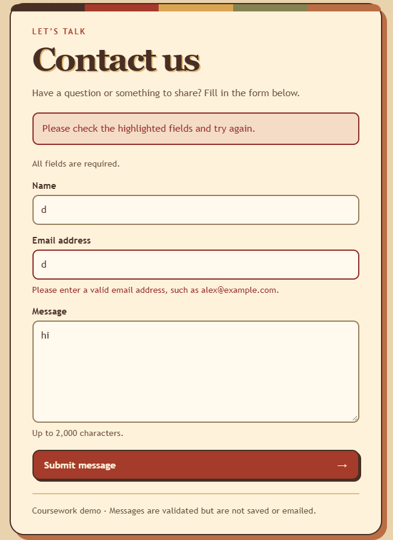
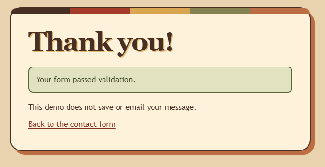

# Website screenshot evidence

These screenshots show the visible results from my Flask contact form.
The original image files are kept unchanged.

## 1. Contact form

The form at /contact includes the name, email and message fields and the
1970s colour scheme.

## 2. Invalid email

An invalid email produces a clear field error. The entered name and message
remain visible so the form can be corrected without starting again.

## 3. Confirmation

A valid submission leads to the separate confirmation page. The page explains
that the demo does not save or email the message.

These screenshots show the interface and its visible responses. They do not
independently prove HTTP status codes or browser-validation bypass; those checks
are covered by the automated test report linked from the comparison write-up.
